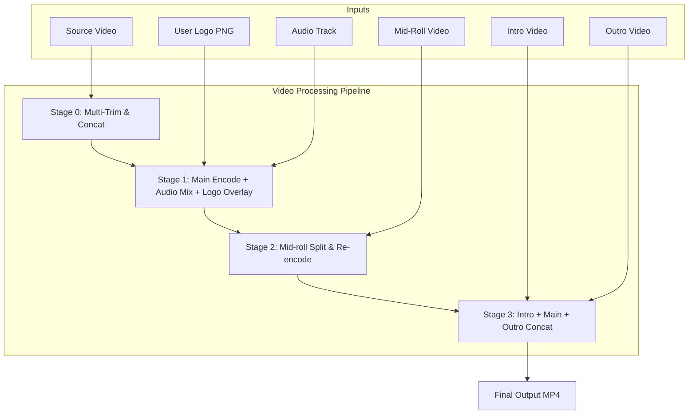
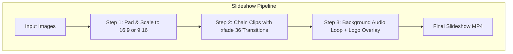

# Video Editor

> **Batch video processing and slideshow maker, powered by FFmpeg**

[](https://github.com/FileifyPK/video-editor/actions)
[](https://opensource.org/licenses/MIT)
[](https://www.python.org/)
[](https://ffmpeg.org/)
[](https://github.com/FileifyPK/video-editor/pulls)

---

## 📸 Overview

Video Editor is a privacy-first, web-based video processing application. It processes videos and slideshows entirely on your local machine using Flask and FFmpeg. Your media files are never sent across the internet or uploaded to any third-party cloud.


*(Note for maintainer: Place UI screenshots in `docs/screenshots/` without exposing personal files or branding).*

---

## ✨ Features

- **Multi-Section Video Trimming:** Define multiple in/out timestamps to cut and seamlessly re-join segments from source videos.
- **Watermark & Logo Overlay:** Overlay custom user-supplied transparent logos (`.png`, `.webp`) with adjustable position (Top Left, Top Right, Bottom Left, Bottom Right, Center), size, margin, and opacity.
- **Comprehensive Audio Controls:**
  - Keep original audio with volume adjustment.
  - Complete audio mute.
  - Full audio replacement with an uploaded music or voiceover track.
  - Multi-track background audio mixing with automatic loop, fade-out, and ducking.
- **Automated Slideshow Builder:** Create smooth videos from ordered photos with 36 hardware/software `xfade` transitions (wipes, slides, zooms, dissolves, circle crops, etc.).
- **Orientation Modes:** One-click toggling between Landscape (16:9 for YouTube/Desktop) and Portrait (9:16 for Reels/Shorts/TikTok).
- **Encoding & Hardware Acceleration:**
  - Standard CPU encoding using `libx264` with configurable CRF presets (High: CRF 18, Medium: CRF 22, Fast: CRF 28).
  - Optional NVIDIA NVENC GPU hardware acceleration (`h264_nvenc`).
- **Intro, Outro & Mid-roll Insertion:** Prepend intro clips, append outro sequences, or insert mid-roll videos at exact timestamps.
- **Batch Processing & Real-time Telemetry:** Multi-file queueing, per-item and overall progress bars, calculated ETAs, and live log polling.
- **Local & Private:** Runs entirely on localhost (`127.0.0.1`).

---

## 🚀 Quick Start

### Windows
Double-click `start.bat` or run in terminal:
```cmd
start.bat
```
This script checks Python and FFmpeg, initializes a local `.venv`, installs dependencies, and opens your browser at `http://127.0.0.1:5000`.

### macOS & Linux
```bash
chmod +x start.sh
./start.sh
```

### Docker
```bash
docker compose up --build
```
Access the application at `http://127.0.0.1:5000`.

---

## 📋 Requirements

- **Python:** 3.9, 3.10, 3.11, 3.12, or 3.13.
- **FFmpeg & FFprobe:** Version ≥ 4.3 (required for `xfade` filter support) available on your system `PATH`.

### Installing FFmpeg

- **Windows:**
  ```cmd
  winget install Gyan.FFmpeg
  ```
  Or download static binaries from [gyan.dev](https://www.gyan.dev/ffmpeg/builds/) and add the `bin` directory to your PATH.
- **macOS:**
  ```bash
  brew install ffmpeg
  ```
- **Ubuntu / Debian:**
  ```bash
  sudo apt update && sudo apt install -y ffmpeg
  ```
- **Fedora / RHEL:**
  ```bash
  sudo dnf install -y ffmpeg
  ```

---

## 🛠 How to Use

1. **Upload Media:** Use the left sidebar to upload videos, photos, logos, and audio tracks.
2. **Configure Settings:** Choose your parameters in the center column tabs (Logo, Trim, Audio, Output, Slideshow).
3. **Execute:** Click **Process Videos** or **Generate Slideshow**.
4. **Monitor & Download:** Watch live terminal output in the right sidebar. When finished, download your rendered MP4s from the Completed Files list.

For an in-depth walkthrough of every tab and option, see [docs/USAGE.md](docs/USAGE.md).

---

## ⚙️ Architecture & Pipeline





For complete technical details, see [docs/ARCHITECTURE.md](docs/ARCHITECTURE.md).

---

## 🔧 Configuration

All settings can be configured via environment variables:

| Variable | Type | Default | Description |
|---|---|---|---|
| `VIDEO_EDITOR_HOST` | String | `127.0.0.1` | Host interface to bind (use `127.0.0.1` for local privacy) |
| `VIDEO_EDITOR_PORT` | Integer | `5000` | HTTP port to listen on |
| `VIDEO_EDITOR_MAX_UPLOAD_GB` | Float | `5` | Maximum allowed request upload size in gigabytes |
| `VIDEO_EDITOR_DEBUG` | Integer | `0` | Enable Flask debug mode (`1` = on, `0` = off) |
| `VIDEO_EDITOR_JOB_TTL_HOURS` | Float | `6` | Hours to retain completed/failed jobs in memory |

Copy `.env.example` to `.env` to customize your local defaults.

---

## 🛡 Security Notice

> [!WARNING]
> Video Editor is designed strictly as a local single-user desktop companion tool without built-in user authentication. By default, it binds exclusively to loopback (`127.0.0.1`).
>
> **Do not bind to `0.0.0.0` or expose this application to public or untrusted networks without placing it behind a secure reverse proxy with strong authentication (e.g., Caddy/Nginx with OAuth or Authelia).**

See [SECURITY.md](SECURITY.md) for full vulnerability reporting procedures and implemented security mitigations.

---

## 📂 Project Structure

```text
video-editor/
├── app.py                      # Core Flask application and worker pipelines
├── templates/
│   └── index.html              # Responsive single-page interface
├── requirements.txt            # Runtime dependencies
├── requirements-dev.txt        # Development, testing, and linting dependencies
├── pyproject.toml              # Ruff and Pytest configurations
├── start.bat                   # Windows one-click launcher
├── start.sh                    # Linux / macOS launcher
├── Dockerfile                  # Containerized deployment definition
├── docker-compose.yml          # Docker Compose specification
├── .dockerignore
├── .gitignore
├── .gitattributes
├── .editorconfig
├── .env.example
├── LICENSE                     # MIT License
├── README.md
├── CHANGELOG.md
├── CONTRIBUTING.md
├── CODE_OF_CONDUCT.md
├── SECURITY.md
├── NOTICE.md
├── docs/
│   ├── USAGE.md                # Tab-by-tab guide and user instructions
│   ├── ARCHITECTURE.md         # Component model and pipeline documentation
│   ├── API.md                  # REST API endpoint specifications
│   ├── TROUBLESHOOTING.md      # Common errors, NVENC notes, and resolutions
│   └── screenshots/
├── tests/
│   ├── conftest.py
│   ├── test_utils.py
│   ├── test_security.py
│   ├── test_routes.py
│   ├── test_identity.py
│   └── test_ffmpeg_integration.py
└── uploads/, outputs/, temp/   # Runtime media directories (.gitkeep preserved)
```

---

## ⚠️ Limitations & Known Issues

1. **In-Memory Job Queue:** Active and completed job records live in memory and will reset if the server process restarts.
2. **Local Disk Usage:** Complex video encodings create temporary working files inside `temp/`. The application automatically cleans up temporary files on completion, error, or restart, but ensure you have adequate scratch disk space.
3. **Hardware Encoding:** NVIDIA NVENC requires compatible NVIDIA graphics hardware and corresponding GPU drivers. If unavailable, use standard CPU encoding.

---

## 🗺 Roadmap

- [ ] Persistent job storage (SQLite backing for job history across restarts).
- [ ] Decoupled modular UI assets (splitting inline scripts and styles into `static/`).
- [ ] Multi-lingual and RTL interface localization.
- [ ] Additional video format output targets (AV1, VP9, WebM).
- [ ] Audio waveform visualization and visual trim markers.

---

## 🤝 Contributing

Contributions are warmly welcomed! Please read [CONTRIBUTING.md](CONTRIBUTING.md) and [CODE_OF_CONDUCT.md](CODE_OF_CONDUCT.md) before submitting pull requests.

---

## 📄 License & Acknowledgements

- **License:** Released under the [MIT License](LICENSE). Copyright (c) 2026 Video Editor contributors.
- **FFmpeg:** FFmpeg is an external requirement and is not bundled with this project. See [NOTICE.md](NOTICE.md).
- **Libraries:** Flask & Werkzeug (BSD-3-Clause).
- **Typography:** Google Fonts (Cinzel, EB Garamond, Josefin Sans) licensed under the SIL Open Font License.
